**Team:** Varun Rao (PES1UG24CS520) · Vedanth Kiran (PES1UG24CS523) · Venkatesh Panda (PES1UG24CS524) · Varshit Gude (PES1UG24CS518)
**Repository:** https://github.com/VenkateshPanda0/ML-Hackathon-

Every number in this report is read from a file in `results/` produced by the scripts in `scripts/`. The file that each table comes from is named under the table. Random seed: 42.

# 1. Problem and pipeline

PathSnap matches noisy 1 Hz GPS observations to a directed road network and outputs the ordered list of road segments (arc ids) the vehicle drove. Our pipeline:

1. **Pre-processing.** Project longitude/latitude to local metres and keep one GPS observation every ≥10 m.
2. **Candidate generation.** Every arc within 50 m of an observation becomes a candidate, keeping at most 8 per observation.
3. **Candidate classifier.** Predicts P(candidate = reference arc) from 12 engineered features.
4. **HMM + Viterbi.** Uses these probabilities as emissions and road-network distances as transitions.
5. **Route assembly.** Joins the chosen arcs with bounded shortest paths into a connected route.

# 2. Dataset understanding and EDA

*Code: `scripts/01_eda.py`. Outputs: `results/eda/`. Partitions: train (80 trips) and student_test (10 trips). The evaluator-testing partition was never available to us and was not used.*

## 2.1 What the files contain (verified)

- `.track`: lon, lat, timestamp (s)
- `.nodes`: lon, lat. The 0-based row number is the node id.
- `.arcs`: from_node, to_node. The 0-based row number is the arc id.
- `.route`: ordered reference arc ids

We checked that every arc endpoint is a valid node index and that consecutive reference arcs share a node (`arcs[r_i].to == arcs[r_{i+1}].from`). GPS rows have no 1-to-1 relationship with node or arc rows.

| Partition | Trips | GPS points | Missing values | Time gaps > 5 s | Trips whose reference route is not fully connected | Mean median GPS→route distance |
|---|---|---|---|---|---|---|
| train | 80 | 208,417 | 0 | 1,216 | 10 | 8.1 m |
| student_test | 10 | 19,160 | 0 | 44 | 1 | 5.1 m |

*Source: `results/eda/partition_overview.csv`*

## 2.2 Observed patterns and data-quality issues

- **No missing values, duplicated timestamps or out-of-order timestamps.** Sampling is mostly 1 s: 93.8% of steps in train and 98.2% in student_test. Some training trips have very large gaps, up to 153,064 s, where the logger was paused. The longest training "trip" spans 2,567 minutes.
- **Trip-specific road networks.** Network size varies from 299 to 155,003 nodes and from 649 to 307,392 arcs per trip. No network has isolated nodes. Each one splits into several weakly connected pieces (1–421 in train), because each trip ships a clipped extract of a larger map.
- **GPS noise.** Measured as distance to the reference route, the median is 3.5–7 m for most trips. The 95th percentile is about 23 m in train. A few trips are much worse; one train trip has a 140 m median. This sets the 50 m candidate radius.
- **Reference-route limitations.** 10 training routes and 1 student-test route contain non-adjacent consecutive arcs. Several routes repeat arcs. We treat the reference as a label with known noise, not as perfect ground truth.
- **Different regions.** Trips come from many regions worldwide (for example around 47.07°N 2.43°E for test trip 00000091), so the projection is computed per trip.

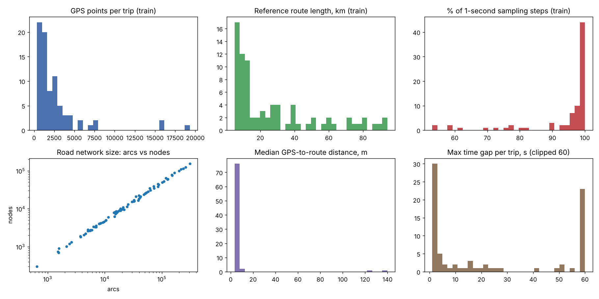

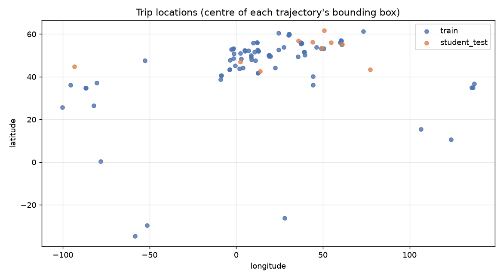

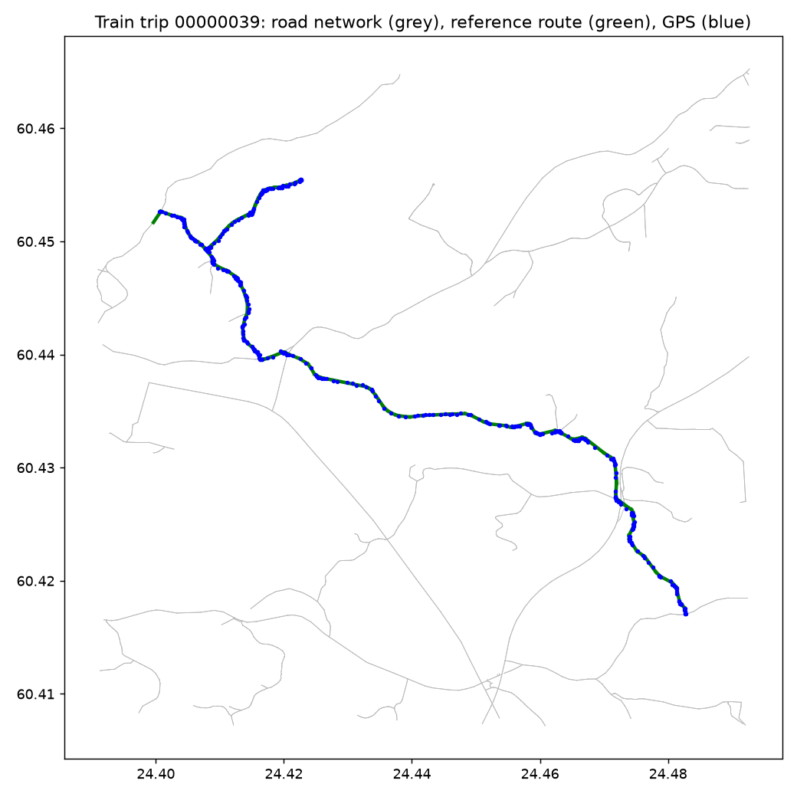

**Folium map (required).** The interactive maps are `results/maps/train_00000039_eda.html` and `results/maps/student_test_<trip>.html`. They have layers for GPS observations, the nearby road network, the reference route and the predicted route, plus a legend and a layer control.

> **[INSERT SCREENSHOT]** Open `results/maps/student_test_00000091.html` in a browser and paste a screenshot here.

## 2.3 Pre-processing

1. **Projection.** Equirectangular projection to metres around each trip's mean GPS position (`pathsnap/geometry.py`). Distances in degrees are not metric. At city scale this projection has negligible error and is much faster than geodesic formulas for millions of point-segment distances.
2. **Observation thinning.** An observation is kept only once it is ≥10 m from the previous kept one. This removes jitter while the vehicle is stopped, which otherwise creates spurious back-and-forth matches. 125,536 training observations were kept.
3. **Candidate generation.** A KD-tree over points sampled every 10 m along every arc, followed by exact point-to-segment projection. Observations with no arc within 50 m are treated as outliers and skipped (4.2% of thinned training observations).
4. **Reference labels per observation.** `.route` is a sequence of arcs, not a label per GPS point. We align the observations to the route with a monotone dynamic program: the route position must never decrease, and total point-to-arc distance is minimised. The arc each observation aligns to is its reference arc, and candidates equal to it get label 1. This is computed from the route only; the evaluation pipeline never sees it.
5. **Candidate miss rate.** The reference arc is absent from the candidate set for **1.82%** of training observations and **0.34%** of student-test observations (`results/candidate_stats_*.csv`).

## 2.4 Features (12 per candidate)

| Feature | Why |
|---|---|
| `dist` | Distance from the GPS point to the arc. This is the main signal. |
| `dist_rank`, `gap_to_nearest`, `dist_ratio`, `is_nearest` | How this candidate compares to the others for the same point. Absolute distance alone is ambiguous when GPS noise varies between trips. |
| `cos_heading`, `abs_heading_diff` | Agreement between the direction of travel (from ±3 neighbouring points) and the arc bearing. Separates the two directions of a two-way road and parallel streets. |
| `moving`, `speed` | Heading is unreliable when the vehicle is (almost) stopped. |
| `end_frac` | Projection near an arc end means the point is at a junction, where ambiguity is highest. |
| `log_arc_len` | Short connector arcs behave differently from long road arcs. |
| `n_cands` | Density of roads around the point. |

Training table: 669,963 candidate rows (17.6% positive). Student test: 75,742 rows (`results/features_*.csv.gz`).

# 3. Model experimentation and comparison

*Code: `pathsnap/models.py`, `scripts/03_train_models.py`, `scripts/07_make_figures.py`. Cross-validation: 5-fold `GroupKFold` with groups = trip, so no trip is split across folds. Each model is then refit on all 80 training trips and evaluated on the 10 student-testing trips.*

**Primary selection metric.** We select on CV log loss, with CV Macro F1 as a cross-check. The HMM uses the classifier's probabilities directly, so probability quality matters more than a thresholded decision.

**Metric definitions:**

- **Macro F1:** candidate-level, threshold 0.5
- **Top-1 accuracy:** per GPS observation, whether the highest-scoring candidate is the reference arc
- **Route continuity:** share of changes in predicted arc between consecutive observations that are physically adjacent

## 3.1 Overall comparison

| Model | Family | Key configuration | CV Macro F1 (±std) | CV Top-1 | Student-test Top-1 | Route continuity (clf-only → +HMM) | Student-test Macro F1 | Log loss (CV / test) | Inference time (ms per 1k candidates) | Fit time (s) |
|---|---|---|---|---|---|---|---|---|---|---|
| M1 Logistic Regression | Linear | StandardScaler, L2, C=1 | 0.9372 ± 0.0104 | 0.9067 | 0.9155 | 0.727 → 0.865 | 0.9394 | 0.1144 / 0.1122 | 0.09 | 1.2 |
| M2 Gaussian Naive Bayes | Probabilistic (generative) | var_smoothing=1e-9 | 0.8910 ± 0.0114 | 0.8994 | 0.9100 | 0.699 → 0.851 | 0.8942 | 0.4093 / 0.3959 | 0.16 | 0.2 |
| M3 KNN | Instance-based | k=25, distance-weighted, scaled, 150k-row subsample | 0.9419 ± 0.0112 | 0.9064 | 0.9208 | 0.737 → 0.873 | 0.9455 | 0.1416 / 0.1304 | 399.0 | 0.2 |
| M4 Random Forest | Ensemble (bagging) | 150 trees, depth 14, min_leaf 5, max_samples 0.3 | **0.9509** ± 0.0088 | **0.9154** | **0.9274** | 0.748 → 0.878 | **0.9524** | **0.0811 / 0.0779** | 4.24 | 37.5 |
| M5 HistGradientBoosting | Boosting | lr 0.1, 200 iters, 31 leaves | 0.9502 ± 0.0084 | 0.9146 | 0.9259 | 0.747 → 0.878 | 0.9508 | 0.0832 / 0.0804 | 1.91 | 3.7 |
| M6 MLP | Neural network | (64, 32) ReLU, Adam, early stopping, 250k-row subsample | 0.9476 ± 0.0096 | 0.9143 | 0.9266 | 0.752 → 0.879 | 0.9505 | 0.0870 / 0.0822 | 0.57 | 17.2 |

*Source: `results/model_comparison.csv`, `results/cv_folds.csv`, `results/hmm_by_model.csv`. Route continuity and route F1 use the default decoder settings.*

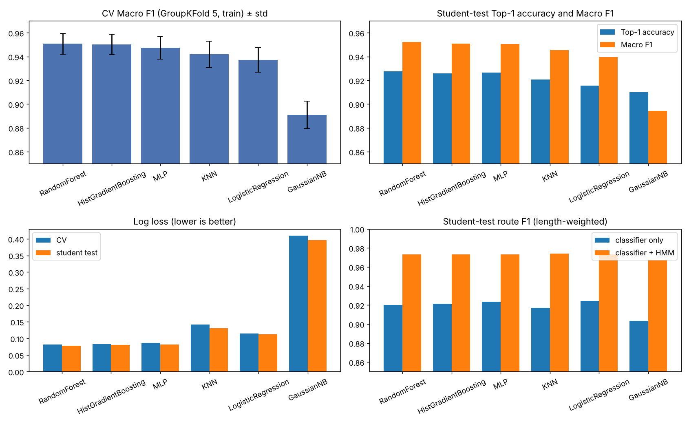

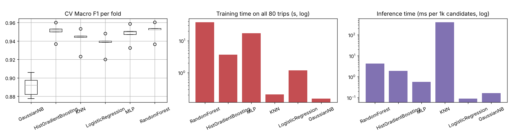

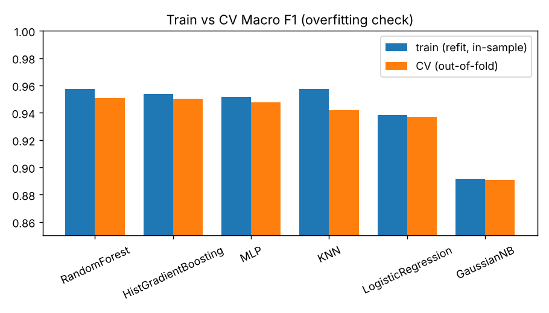

**Model selection.** Random Forest and HistGradientBoosting (HGB) are statistically tied:
- CV Macro F1 differs by 0.0007, less than one fold standard deviation (≈0.009).
- CV log loss differs by 0.002.
- After HMM decoding, route F1 is identical to three decimals (0.973).

HGB trains about 10× faster (3.7 s vs 37.5 s), runs inference about 2× faster, and its saved model is about 100× smaller (0.4 MB vs 39 MB). That matters for the two-laptop deployment and for repeated Bayesian-optimisation trials. It also has the lowest fold-to-fold variance (std 0.0084). **We selected HGB** for Bayesian optimisation and deployment.

## 3.2 Per-model questions

Answers for each model: A = suitability and strengths/limitations, B = hyperparameters and objective, C = results and over/under-fitting.

### M1 - Logistic Regression
- **A.** A linear baseline that gives calibrated probabilities, which is a natural fit for HMM emissions. Its weakness is that it cannot model interactions, for example "small distance matters less when heading disagrees".
- **B.** Inputs standardised; L2 penalty with C=1.0; lbfgs solver with max_iter=1000. Objective: binary cross-entropy (log loss).
- **C.** Student test: Top-1 0.9155, Macro F1 0.9394, log loss 0.1122. Train Macro F1 0.9383 vs CV 0.9372 shows no overfitting. It is about 0.013 below the tree ensembles, a mild underfit from its linear decision boundary. After HMM decoding its route F1 (0.9731) almost matches the best model, because the decoder fixes most of the ranking errors.

### M2 - Gaussian Naive Bayes
- **A.** A fast generative baseline. Its feature-independence assumption is badly violated here: `dist`, `dist_rank`, `gap_to_nearest` and `dist_ratio` are strongly correlated.
- **B.** var_smoothing=1e-9. Objective: maximum likelihood of the class-conditional Gaussians.
- **C.** Student test: Top-1 0.9100, Macro F1 0.8942, log loss 0.3959, the worst of all models. Its probabilities are over-confident because correlated features are counted several times. Train ≈ CV (0.8915 vs 0.8910), so this is underfitting or model misspecification, not overfitting. It has high recall (0.935) but low precision (0.748) at threshold 0.5.

### M3 - K-Nearest Neighbours
- **A.** Candidates with similar geometry (distance, heading, rank) should share labels. Its limitations are that it needs scaling, has costly inference, and gives coarse probabilities.
- **B.** k=25, distance-weighted, Euclidean on standardised features, trained on a 150k-row random subsample to keep queries tractable. There is no explicit loss: it is a lazy learner.
- **C.** Student test: Top-1 0.9208, Macro F1 0.9455, log loss 0.1304. Train Macro F1 0.9575 vs CV 0.9419 is the largest train-CV gap, consistent with distance weighting memorising training points. Inference is the slowest by far (399 ms per 1k candidates), which rules it out for the API.

### M4 - Random Forest
- **A.** Captures non-linear interactions between distance, heading and junction position, and bagging keeps variance low. Its limitations are model size and fit time.
- **B.** 150 trees, max_depth=14, min_samples_leaf=5, max_samples=0.3. Objective: Gini impurity per split.
- **C.** Student test: Top-1 0.9274, Macro F1 0.9524, log loss 0.0779, the best classifier-only numbers. The train-CV gap (0.9575 vs 0.9509) shows mild overfitting, controlled by depth and leaf limits. Test is not worse than CV. It was not selected because of cost (see 3.1).

### M5 - HistGradientBoosting (selected)
- **A.** Boosting on histogram-binned features fixes the residual errors of earlier trees and handles the mixed-scale features without scaling. It is fast and compact. Its limitation is sensitivity to learning rate and tree size, which is why it was tuned.
- **B.** Initial values: learning_rate=0.1, max_iter=200, max_leaf_nodes=31, min_samples_leaf=20, no L2. Objective: binary log loss.
- **C.** Student test: Top-1 0.9259, Macro F1 0.9508, log loss 0.0804. Train 0.9537 vs CV 0.9502 is a small gap, with no meaningful over- or under-fitting. It has the lowest fold standard deviation of all models.

### M6 - Multi-layer Perceptron
- **A.** Learns smooth non-linear feature combinations. Its limitations are that it needs scaling, is sensitive to initialisation, and trains more slowly on CPU.
- **B.** Hidden layers (64, 32), ReLU, Adam, alpha=1e-4, early stopping on a 10% validation split, max 60 epochs, 250k-row subsample. Objective: log loss.
- **C.** Student test: Top-1 0.9266, Macro F1 0.9505, log loss 0.0822. Train 0.9517 vs CV 0.9476 shows no overfitting; early stopping halted training. Its epoch-wise loss curve is stored in the fitted object (`artifacts/models/MLP.joblib`, attribute `loss_curve_`). We did not plot it separately.

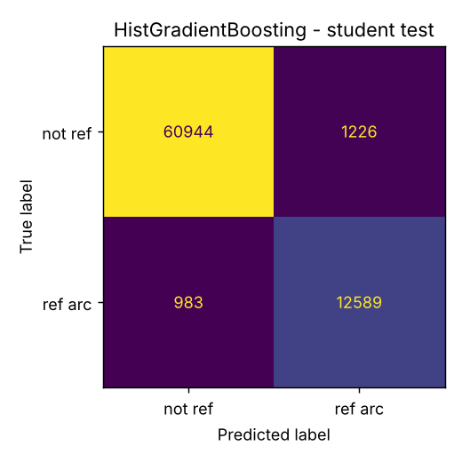{width=40%}

Confusion matrices for all six models are in `results/figures/confusion_<model>.png`.

# 4. Bayesian hyperparameter optimisation (HistGradientBoosting)

*Code: `scripts/04_bayes_opt.py`. Trial record: `results/bayes_opt_trials.csv`. Best configuration: `results/bayes_opt_best.json`. Log: `results/logs/bayes_opt.log`.*

1. **Hyperparameters searched:** learning_rate, max_iter, max_leaf_nodes, min_samples_leaf, l2_regularization, max_features.
2. **Ranges:**

   - learning_rate: log-uniform [0.01, 0.3]
   - max_iter: integer [100, 600]
   - max_leaf_nodes: integer [15, 127]
   - min_samples_leaf: integer [10, 300]
   - l2_regularization: log-uniform [1e-4, 10]
   - max_features: uniform [0.5, 1.0]
3. **Objective:** minimise mean log loss over 3-fold GroupKFold (groups = trip) on the 80 training trips. The sampler is Optuna TPE (seed 42), and the untuned configuration was enqueued as trial 0.
4. **Trials:** 30, taking 1,297 s in total.
5. **Best configuration:**

   - learning_rate 0.0125
   - max_iter 471
   - max_leaf_nodes 94
   - min_samples_leaf 271
   - l2_regularization 4.9e-4
   - max_features 0.61

   Best CV log loss: 0.08138, vs 0.08394 for trial 0.
6. **Did tuning help?** Yes, consistently but modestly:

| | CV log loss | CV Macro F1 | CV Top-1 | Test Top-1 | Test Macro F1 | Test log loss | HMM route F1 | Fit time (s) | Inference, 75.7k test candidates (s) |
|---|---|---|---|---|---|---|---|---|---|
| HGB untuned | 0.0835 | 0.9491 | 0.9150 | 0.9259 | 0.9508 | 0.0804 | 0.9732 | 3.4 | 0.10 |
| HGB tuned | **0.0814** | **0.9500** | **0.9160** | **0.9294** | **0.9529** | **0.0771** | **0.9741** | 22.5 | 0.70 |

*Source: `results/tuned_vs_untuned.csv`. Both models were evaluated on identical partitions with the default decoder.*

The search favoured many shallow-learning-rate iterations with large minimum leaf sizes and feature subsampling, which are regularising choices. The cost is about 7× slower inference. That is still only 0.7 s for the whole student-test set, so we kept the tuned model.

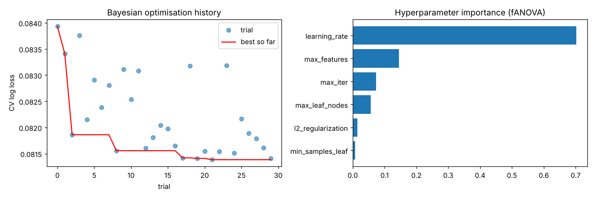

# 5. HMM and Viterbi route reconstruction

*Code: `pathsnap/hmm.py`, `pathsnap/graph.py`, `scripts/05_hmm_eval.py`.*

1. **Hidden states.** One state per candidate of an observation: (arc id, projection fraction along the arc). The candidate-to-arc correspondence is preserved through the whole pipeline.
2. **Emissions.** `w · log P_clf(candidate is reference)` from the tuned HGB, clipped at 1e-6, with w = `emission_weight`.
3. **Transitions.** Following Newson & Krumm, log P = −|d_network − d_straight| / β.
   - d_straight is the distance between the two GPS points.
   - d_network = remaining part of the previous arc + Dijkstra distance between arc end and start node + part of the next arc.
   - Dijkstra is bounded at 4·d_straight + 300 m.
   - On the same arc, forward movement costs its length. Backward movement up to 30 m is treated as GPS jitter ("stay").
4. **Missing candidates and gaps.**
   - Observations with no arc within 50 m are dropped as outliers.
   - Time gaps need no special case: the transition compares network distance with straight-line distance, so a long gap simply allows a long network path.
   - Thinning to ≥10 m spacing removes stationary jitter.
5. **Disconnected consecutive candidates.** When no candidate is reachable within the bound, the transition gets a finite "jump" penalty (`jump_penalty`) instead of −∞.
   - This was necessary. With −∞, one wrong choice at a fork (two arcs leaving the same node) left no reachable continuation and broke the chain. On train trip 00000010 that produced a route 8× too long.
   - When assembling the route, consecutive chosen arcs are joined by the shortest path if it is shorter than 3·d_straight + 500 m. Otherwise a gap is left rather than inventing a long detour.
   - Short closed loops (≤1.5 km) created at junctions are removed.
6. **Decoding.** The Viterbi recurrence is δ_t(j) = max_i [δ_{t−1}(i) + log A_ij] + w·log e_t(j), with back-pointers and a backtrack from argmax δ_T.

**Decoder tuning.** We used out-of-fold (5-fold GroupKFold) probabilities on 25 training trips, so the decoder never saw in-sample probabilities. A grid search covered β ∈ {5, 10, 20}, w ∈ {0.5, 1, 2} and jump ∈ {20, 40}, with mean route F1 as the objective (`results/decoder_grid.csv`). Chosen: β = 10, w = 0.5, jump = 20. The grid was flat: all 18 settings scored between 0.939 and 0.943 OOF route F1, so the decoder is robust to these settings.

**Classifier-only vs classifier + HMM (student test, tuned HGB, tuned decoder)**

| | Observation-level accuracy | Continuity | Route precision | Route recall | Route F1 | Route mismatch fraction | Decode time per trip (s) |
|---|---|---|---|---|---|---|---|
| Classifier only (top-1 per observation, then shortest-path join) | 0.9264 | 0.7457 | 0.8961 | 0.9572 | 0.9239 | 0.1644 | 0.09 |
| Classifier + HMM / Viterbi | **0.9608** | **0.8807** | **0.9844** | **0.9643** | **0.9739** | **0.0509** | 0.28 |

*Source: `results/hmm_vs_classifier_summary.csv`, `results/hmm_vs_classifier_by_trip.csv`. Route precision, recall and F1 are weighted by arc length. Mismatch fraction = (wrongly added + wrongly missing length) / reference length.*

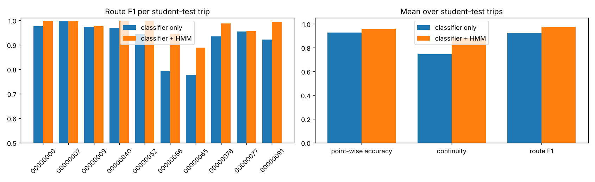

**Did HMM decoding improve the route?** Yes.

- Route F1 improved on 9 of 10 trips and was unchanged on the 10th: mean 0.924 → 0.974, and the mismatch fraction dropped by about 3×.
- The biggest gain is precision (0.896 → 0.984). Classifier-only routes zig-zag between parallel or opposite-direction arcs, and the connecting paths add wrong road length. The HMM refuses moves whose network distance does not match the GPS displacement.

**Where the HMM did not help:**

- Trips 00000007 (0.996 → 0.996) and 00000077 (0.955 → 0.956): the classifier was already right, or the remaining errors are close parallel roads where both hypotheses are geometrically consistent.
- Trip 00000065 is the weakest result (0.889). Its route recall stays low because the GPS cuts across a junction area where the reference takes arcs the observations never come near.
- **Exact route match is 0 for both methods.** A single missing short connector arc breaks exactness, so we report it but do not optimise for it.
- **Continuity below 1 even with the HMM.** Observations 10 m apart can skip a very short arc, which counts as non-adjacent. The final assembled route fills these gaps with shortest paths.

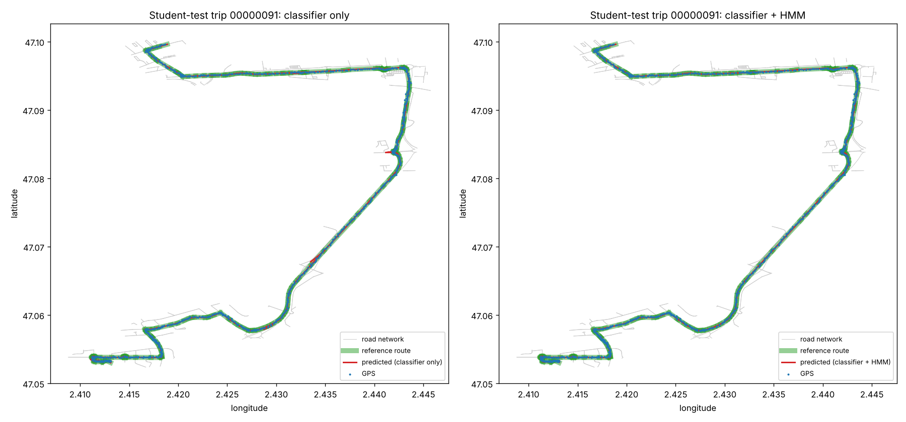

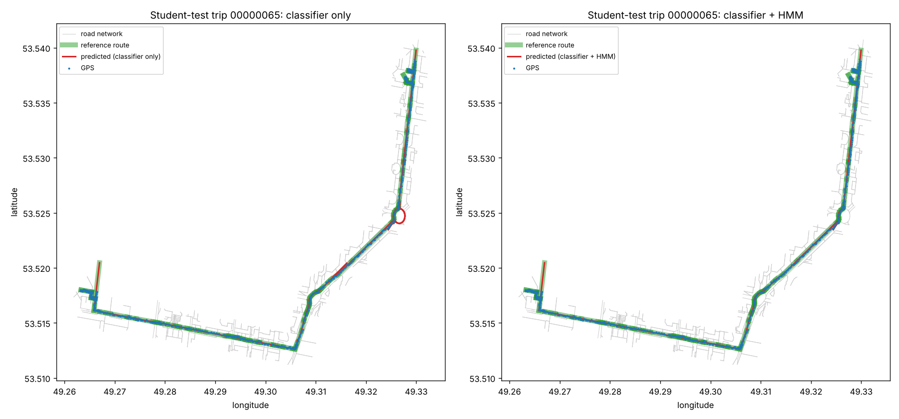

# 6. Geographical visualisation (Folium)

`pathsnap/viz.py` and `scripts/06_folium_maps.py` generate one interactive map per trip in `results/maps/`. Each map has:
- Separate toggleable layers (via a layer control) for GPS observations (blue), the road network within 150 m of the track (grey), the reference route (wide green) and the predicted route (red)
- Start and end markers
- A legend that includes the trip's route F1
- Automatic zoom to the trajectory

> **[INSERT SCREENSHOT]** `results/maps/student_test_00000091.html`

> **[INSERT SCREENSHOT]** `results/maps/student_test_00000065.html`

# 7. API, UI and deployment

- **Laptop 1 (API).** `uvicorn api.app:app --host 0.0.0.0 --port 8000`. FastAPI endpoints:
  - `GET /health`
  - `GET /trips`: lists the ten evaluation trip ids from `data/evaluator_test/`
  - `POST /predict {"trip_id"}`
- **What `/predict` does.** It loads `.track/.nodes/.arcs` only (`with_route=False`), then runs candidates → tuned HGB → HMM/Viterbi. Only after that does it read the reference route, server-side, to compute route precision, recall, F1, mismatch, continuity and observation-level accuracy. Every request and result is logged in the terminal.
- **Laptop 2 (UI).** `ui/index.html`, served with `python -m http.server 8080`. The evaluator enters the API address, sees the ten trips as buttons, picks one, and the UI shows the GPS points, predicted route and metrics on a Leaflet map. The UI never receives the reference route geometry.
- **Smoke test.** On the student-test trips, `/predict` returned in about 0.4–1.1 s per trip.

> **[INSERT SCREENSHOT]** UI on Laptop 2 after selecting a trip.

> **[INSERT SCREENSHOT]** API terminal on Laptop 1 showing the `PREDICT`/`RESULT` log lines and `POST /predict ... 200`.

# 8. Limitations, integrity and AI-use disclosure

- **Reference labels.** Labels come from our monotone alignment of the observations to the reference route. Where the reference itself is disconnected (11 trips) or GPS is far off, labels are uncertain.
- **Candidate miss rate.** 1.8% of training observations have no correct candidate, which sets a ceiling on achievable accuracy.
- **Test set use.** The student-test partition was used only for development-stage comparison. Model choice, hyperparameters and decoder settings were chosen with training-trip cross-validation. No evaluator-testing data was used, and no prediction is hard-coded.
- **AI assistance.** This project used an AI assistant (Claude) to help write code and draft this report. All experiments were actually executed, and all reported numbers come from the committed result files. The team has reviewed the code and results and can explain them. *(Edit this statement to match your event's disclosure policy.)*
